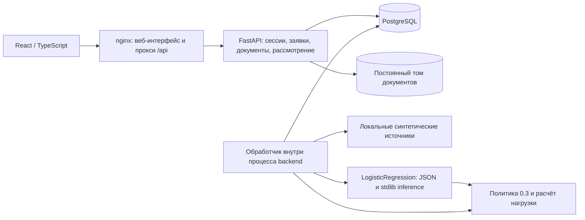
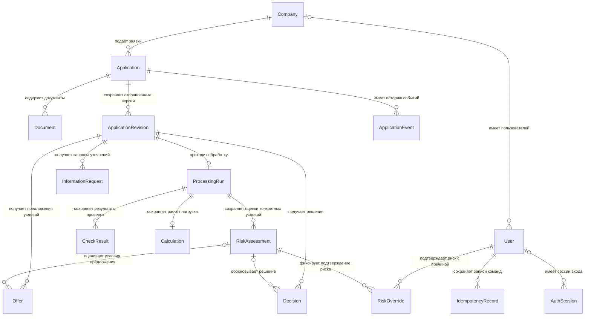
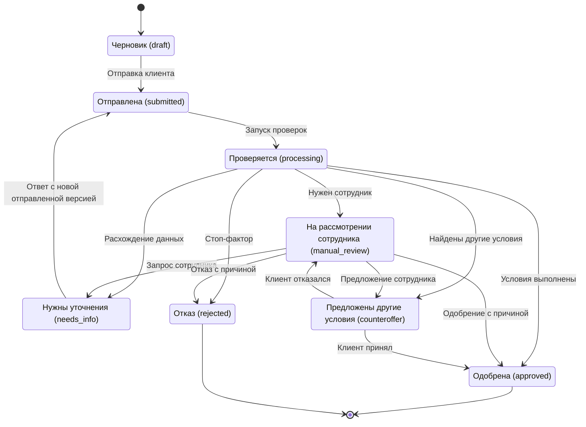

# Архитектура кредитного кабинета

Клиент и сотрудник работают с одной заявкой, но видят разные данные и команды. Отправленные данные сохраняются отдельными снимками; проверки и причины результата относятся к конкретному снимку.

## Компоненты

Docker Compose запускает PostgreSQL, backend и frontend; локально доступен только frontend на `127.0.0.1:8080`. Серверное дополнение добавляет Caddy с HTTPS. Backend применяет Alembic-миграции перед запуском API. Файлы не хранятся в образе контейнера: используются тома `postgres_data` и `document_data`.

Внутри одного процесса backend запускается поток обработки. Он забирает зафиксированные `pending`-запуски из БД. При старте оставшиеся `pending/running` помечаются `interrupted`; сотрудник явно повторяет обработку. Сбой не является кредитным отказом. Несколько процессов backend и внешняя надёжная очередь этой конфигурацией не предусмотрены.

## Модель данных

Названия сущностей сохранены как в коде. Подписи линий описывают связи между записями, а не порядок выполнения действий. Обозначения на концах линии: `||` — ровно одна запись, `o|` — ноль или одна, `o{` — ноль или несколько.

`ApplicationRevision` — снимок отправленных данных заявки, `ProcessingRun` — отдельный запуск проверок, `IdempotencyRecord` — запись для защиты команды от повторного выполнения.

`Application` содержит рабочие поля, статус и счётчик `version`. `ApplicationRevision.snapshot` фиксирует компанию, продукт, финансы, документы и подтверждения при отправке. Ответ на уточнение создаёт новый снимок; сохранение формы и загрузка файла сами по себе не возобновляют обработку. Ранее отправленные документы удалить нельзя.

`ProcessingRun` хранит техническое состояние `pending/running/succeeded/failed/interrupted`, версии каталога, правил и синтетического источника, время и причину сбоя. Проверки, расчёт и результат связаны с ним и снимком. `RiskAssessment` хранит версию модели `logistic-risk-v1`, схему признаков, цель/горизонт, точные условия и fingerprint, вероятность, категорию и линейные вклады в `raw_log_odds`. Исходные и предлагаемые условия оцениваются отдельно той же закреплённой моделью; оценка связана с revision/run/attempt. Успешная оценка неизменяема. `RiskOverride` фиксирует сотрудника, оценку и причину осознанного решения при повышенном риске. Пропущенная из-за неполноты/стоп-фактора оценка имеет `not_applicable` и причину; сбой — `failed` без выдуманной вероятности. Старые запуски `demo-policy-0.2` остаются на своей версии, без модельного риска. Ручное решение хранит автора и обязательную причину. Предложение имеет собственную версию и состояние `active/accepted/declined/superseded`. События истории сохраняют автора, время и связи с версиями.

Деньги передаются JSON-целыми копейками (до `9_007_199_254_740_991`, дополнительно действуют границы продукта), срок — целыми месяцами. Расчёт использует десятичную арифметику. Средние месячные показатели получают делением сумм за период на число завершённых календарных месяцев.

## Жизненный цикл

В `draft` и `needs_info` клиент может сохранять рабочие данные. В остальных состояниях отправленные параметры закрыты для редактирования. `available_actions` сообщает разрешённые команды; сервер заново проверяет роль, владельца, статус и версии. Отказ клиента от предложения возвращает заявку сотруднику. Одобрение не означает подписание договора или перевод денег.

## Правила демонстрации

Оба продукта используют фиксированные 24% годовых для аннуитетного расчёта. Оборотный кредит: 100 000–5 000 000 ₽, 3–24 месяца; оборудование: 300 000–10 000 000 ₽, 6–36 месяцев. Это демонстрационные параметры.

Новые отправки используют `demo-policy-0.3`. Сначала проверяется техническое завершение источников, затем полнота и расхождения данных. Ликвидация или просрочка от 90 дней приводят к отказу до ML. В остальных случаях обязателен прогноз события 90 дней просрочки по рассматриваемому кредиту за первые 12 календарных месяцев. При p ≥ 0.10 требуется сотрудник; при p ≥ 0.30 показывается высокий риск. Возраст бизнеса менее шести месяцев, просрочка 1–89 дней или неположительный поток также требуют сотрудника. Низкий риск p < 0.10 позволяет автоматическое одобрение только при остальных правилах и покрытии `K = (R − O) / (D + P) ≥ 1.30`. `R/O/D` — месячные выручка, расходы и текущие платежи, `P` — новый аннуитетный платёж с округлением вверх до копейки. K = 1.30 означает, что поток после операционных расходов покрывает все кредитные платежи с запасом 30%; это не вероятность и не банковский норматив.

При низком риске и недостаточном покрытии алгоритм сначала ищет больший срок с исходной суммой, затем уменьшает сумму на максимальном сроке с округлением вниз до 1 000 ₽ и повторной проверкой. Найденные условия заново оцениваются той же моделью: автоматическое предложение допускается только при их p < 0.10. Если варианта нет или его риск повышен, нужен сотрудник.

Одобрение и предложение сотрудника проверяют полноту, границы продукта, покрытие и стоп-факторы. Для p ≥ 0.10 дополнительно обязательны `risk_acknowledged: true` и содержательная причина. Для новых условий сервер сначала сохраняет отдельную оценку; `409 risk_acknowledgement_required` не меняет version заявки и не создаёт предложение. Интерфейс обновляет оценку, показывает новые условия и риск перед отдельным подтверждением. После подтверждения сохраняется аудит; принятие предложения проверяет его неизменяемый контекст. Отклонение заявки сотрудником по-прежнему требует причины; одного ML для автоматического отказа недостаточно.

Модель поставляется в `app/risk/models/logistic-risk-v1.json` с SHA256 и проверкой схемы, коэффициентами и train-медианами/масштабированием. Инференс и точные линейные вклады работают на стандартной библиотеке Python, без обучения при старте и без ML extra. Нет файла или несовместимая версия — технический `failed`, без решения и fallback; retry сохраняет версии. Объяснения относятся к прогнозу, не доказывают причинность и не заменяют причины кредитного решения.

Документы проверяются по формату/размеру и доступны сотруднику. Источники не читают финансовые числа из файлов: они берутся из формы. Реальные ФНС/БКИ, OCR и LLM/RAG не подключены.

## API и защита данных

Полная схема доступна в [OpenAPI запущенного приложения](http://localhost:8080/api/v1/openapi.json), интерфейс запросов — [Swagger UI](http://localhost:8080/api/v1/docs). [HTTP-примеры](api-examples.http) показывают вход, создание и отправку, уточнение, предложения и ручные решения без второй копии схемы.

- Сессия хранится на сервере, cookie — HttpOnly, на HTTPS — Secure. Выход отзывает сессию, срок по умолчанию восемь часов. Изменяющие запросы требуют CSRF-токен; вход обновляет его.
- Клиент видит заявки своей компании. Сотрудник видит отправленные заявки и внутреннюю оценку; черновики других компаний ему не открываются. Чужой объект возвращает `404`.
- Мутации проверяют `expected_version` под блокировкой заявки. Команды отправки/рассмотрения требуют `Idempotency-Key: UUID`; одинаковые ключ и тело возвращают прежний результат, изменение тела под тем же ключом — `409`.
- Документы передаются бинарным телом с MIME PDF/PNG/JPEG, типом, именем и версией в query. Предел — 10 МиБ, проверяется фактический формат; имя не является путём хранения. Скачивание также проверяет права.
- Ошибки: `401` — вход, `403` — роль/операция, `404` — отсутствующий или чужой объект, `409` — версия/состояние/повтор, `422` — данные, `413/415` — размер/тип файла, `503` — временная техническая недоступность. Клиент не получает внутренние основания через общую карточку.

Миграции и проверки запуска описаны в [README](../README.md), серверная конфигурация и резервирование БД вместе с файлами — в [инструкции развёртывания](deployment.md).
