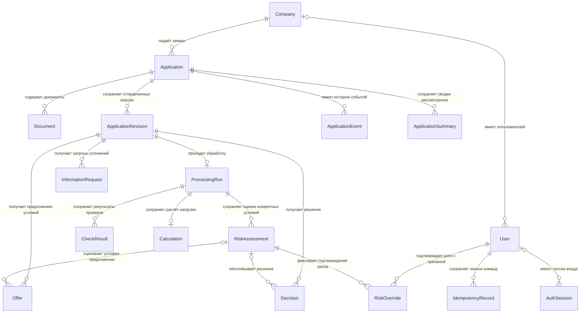
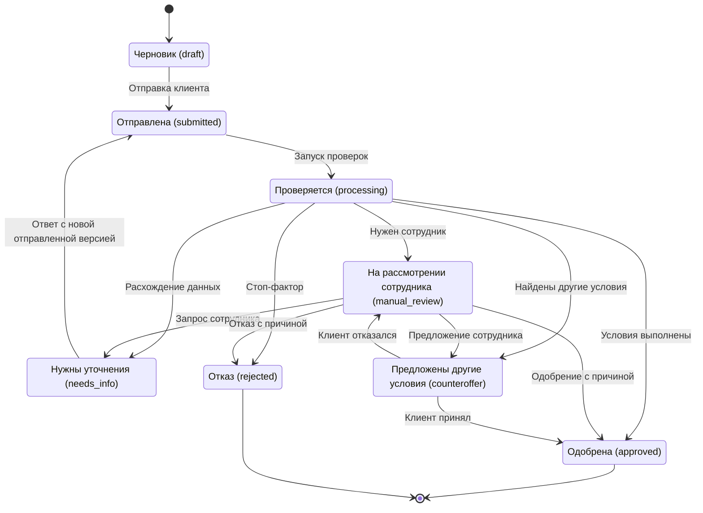

# Архитектура кредитного кабинета

Клиент и сотрудник работают с одной заявкой, но видят разные данные и команды. Отправленные данные сохраняются отдельными снимками; проверки и причины результата относятся к конкретному снимку.

## Компоненты

Docker Compose запускает PostgreSQL, backend и frontend; локально доступен только frontend на `127.0.0.1:8080`. Серверное дополнение добавляет Caddy с HTTPS. Backend применяет Alembic-миграции перед запуском API. Файлы не хранятся в образе контейнера: используются тома `postgres_data` и `document_data`.

Внутри одного процесса backend запускается поток обработки. Он забирает зафиксированные `pending`-запуски из БД. При старте оставшиеся `pending/running` помечаются `interrupted`; сотрудник явно повторяет обработку. Сбой не является кредитным отказом. Несколько процессов backend и внешняя надёжная очередь этой конфигурацией не предусмотрены.

## Модель данных

Названия сущностей сохранены как в коде. Подписи линий описывают связи между записями, а не порядок выполнения действий. Обозначения на концах линии: `||` — ровно одна запись, `o|` — ноль или одна, `o{` — ноль или несколько.

`ApplicationRevision` — снимок отправленных данных заявки, `ProcessingRun` — отдельный запуск проверок, `IdempotencyRecord` — запись для защиты команды от повторного выполнения.

`Application` содержит рабочие поля, статус и счётчик `version`. Инвестиционный кредит дополнительно хранит `project_description`, гарантия — `tender_number` и `beneficiary_name`; для отправки эти поля обязательны. При смене продукта несовместимые поля очищаются, финансы сохраняются. `ApplicationRevision.snapshot` фиксирует компанию, продукт, финансы, документы и подтверждения при отправке. Ответ на уточнение создаёт новый снимок; сохранение формы и загрузка файла сами по себе не возобновляют обработку. Ранее отправленные документы удалить нельзя.

`ProcessingRun` хранит техническое состояние `pending/running/succeeded/failed/interrupted`, версии каталога, правил и синтетического источника, время и причину сбоя. Проверки, расчёт и результат связаны с ним и снимком. `RiskAssessment` хранит версию модели `logistic-risk-v1`, схему признаков, цель/горизонт, точные условия и fingerprint, вероятность, категорию и линейные вклады в `raw_log_odds`. Для оборотного кредита и оборудования исходные и предлагаемые условия оцениваются отдельно той же закреплённой моделью; оценка связана с revision/run/attempt. Успешная оценка неизменяема. `RiskOverride` фиксирует сотрудника, оценку и причину осознанного решения при повышенном риске. Пропущенная из-за неполноты/стоп-фактора оценка имеет `not_applicable` и причину; сбой — `failed` без выдуманной вероятности. У четырёх новых продуктов после обязательных проверок сохраняется `not_applicable / unsupported_product`: вероятность, категория, модель, цель и горизонт равны `null`, вклады пусты. Эта запись привязана к точным условиям; произвольный пропуск оценки не разрешает решение. Старые запуски `demo-policy-0.2` остаются на своей версии, без модельного риска. Ручное решение хранит автора и обязательную причину. Предложение имеет собственную версию и состояние `active/accepted/declined/superseded`. События истории сохраняют автора, время и связи с версиями.

Деньги передаются JSON-целыми копейками (до `9_007_199_254_740_991`, дополнительно действуют границы продукта), срок — целыми месяцами. Расчёт использует десятичную арифметику. Средние месячные показатели получают делением сумм за период на число завершённых календарных месяцев.

`Application.display_number` — постоянный номер вида `КЗ-000123`; его числовая часть выдаётся PostgreSQL sequence, старые заявки получают номера миграцией. Возможны пропуски после отменённых транзакций. UUID остаётся идентификатором в API и маршрутах; номер не меняет правила доступа.

## Жизненный цикл

В `draft` и `needs_info` клиент может сохранять рабочие данные. В остальных состояниях отправленные параметры закрыты для редактирования. `available_actions` сообщает разрешённые команды; сервер заново проверяет роль, владельца, статус и версии. Отказ клиента от предложения возвращает заявку сотруднику. Одобрение не означает подписание договора или перевод денег.

## Правила демонстрации

Каталог `demo-v2` поддерживает шесть продуктов. Ставки и комиссии ниже — параметры симуляции, не тарифы Альфа-Банка. Базисный пункт (`bps`) равен 0.01 процентного пункта: 2400 bps = 24%.

| Продукт / код | Сумма или лимит | Срок, мес. | Проценты / комиссия | Документы помимо финансовой отчётности |
| --- | --- | --- | --- | --- |
| Оборотный / `working_capital` | 100 тыс.–5 млн ₽ | 3–24 | 24% годовых | — |
| Оборудование / `equipment` | 300 тыс.–10 млн ₽ | 6–36 | 24% годовых | Счёт на оборудование |
| Овердрафт / `overdraft` | 100 тыс.–3 млн ₽ | 1–3 | 21% годовых | Выписка по счёту |
| Кредитная линия / `credit_line` | 500 тыс.–15 млн ₽ | 6–24 | 20% годовых + 0.5% разово | Выписка по счёту |
| Инвестиционный / `investment` | 3–100 млн ₽ | 24–120 | 16% годовых + 1.5% разово | Бизнес-план |
| Гарантия / `tender_guarantee` | 100 тыс.–20 млн ₽ | 1–36 | Комиссия 3% годовых за весь срок, разово | Документы по тендеру |

Новые отправки используют `demo-v2` / `demo-policy-0.4`. Сначала проверяется техническое завершение источников, затем полнота и расхождения данных. Ликвидация или просрочка от 90 дней приводят к отказу до ML. Оборотный кредит и оборудование сохраняют обязательный прогноз события 90 дней просрочки по рассматриваемому кредиту за первые 12 календарных месяцев. При p ≥ 0.10 требуется сотрудник; при p ≥ 0.30 показывается высокий риск. Возраст бизнеса менее шести месяцев, просрочка 1–89 дней или неположительный поток также требуют сотрудника. Низкий риск p < 0.10 позволяет автоматическое одобрение только при остальных правилах и покрытии K ≥ 1.30. У новых четырёх продуктов нет автоматического одобрения или автоматического предложения: после обязательных проверок они переходят сотруднику.

### Расчёт условий

Одна функция `calculate_terms` используется в подборе, рассмотрении и предложении. `PaymentTerms` фиксирует вид `payment_kind`, сумму, срок, ставку или комиссию, месячный платёж, разовую комиссию, возврат в конце срока, последний платёж, общую выплату, стоимость, расчётную нагрузку, условное обязательство и допущения. Денежные компоненты округляются вверх до копейки; `ceil` ниже означает это же округление. Это упрощённый сценарий, без календарного графика и расчёта ПСК.

Обозначения: S — сумма/лимит/сумма гарантии, n — месяцы, R/O/D — средние месячные выручка, операционные расходы и действующие платежи, C — разовая комиссия, B — расчётная нагрузка.

- `annuity`: оборотный, оборудование, инвестиционный. Годовая ставка берётся в долях единицы, месячная `r=ставка/12`; платёж `P = S*r*(1+r)^n / ((1+r)^n−1)`. Итог `P*n+C`, стоимость `итог−S`, нагрузка первого месяца `B=P+C`.
- `revolving`: овердрафт и линия. Предполагается полное использование лимита весь срок. Ежемесячно платятся проценты `I=S*годовая_ставка/12`, в конце возвращается весь S; последний платёж `S+I`. Итог `S+I*n+C`, стоимость `I*n+C`. Нагрузка `B=I+ceil(S/n)+C` включает расчётный резерв возврата лимита; резерв не является договорным платежом или накопленными деньгами.
- `guarantee`: разовая комиссия `C=S*0.03*n/12`. Итог и стоимость равны C, условная обязанность возмещения равна S. Выдаваемой суммы и обычного возврата основного долга нет; ставка, месячный платёж и B равны `null`, возврат/последний платёж — 0. Возмещение возможно при исполнении гарантии и не входит в обычную выплату комиссии.

Для аннуитета и лимита ручной финансовый допуск требует `K=(R−O)/(D+B)≥1.30`; комиссия целиком учитывается в первом месяце. K=1.30 означает запас потока 30% сверх суммы обязательств, а не вероятность. Для гарантии K не считается: комиссия должна укладываться в `max(R−O−D,0)`, а обязательство — в `0.5*12*R`. Годовая выручка оценена по выбранному периоду. Эта проверка не доказывает способность возместить гарантию. При недостаточном допуске новых продуктов сотрудник запрашивает сведения, предлагает допустимые условия или отказывает с причиной; автоматического отказа по одной нехватке покрытия нет.

### Решения и история

Для оборотного кредита и оборудования при низком риске и недостаточном покрытии алгоритм сначала ищет больший срок с исходной суммой, затем уменьшает сумму на максимальном сроке с округлением вниз до 1 000 ₽ и повторной проверкой. Найденные условия заново оцениваются той же моделью: автоматическое предложение допускается только при их p < 0.10. Если варианта нет или его риск повышен, нужен сотрудник.

Одобрение и предложение сотрудника проверяют полноту, границы продукта, покрытие и стоп-факторы. Для исходных двух продуктов при p ≥ 0.10 дополнительно обязательны `risk_acknowledged: true` и содержательная причина. Для новых условий сервер сначала сохраняет отдельную оценку; `409 risk_acknowledgement_required` не меняет version заявки и не создаёт предложение. Интерфейс обновляет оценку, показывает новые условия и риск перед отдельным подтверждением. После подтверждения сохраняется аудит; принятие предложения проверяет его неизменяемый контекст. Для новых четырёх нужны обычное основание и финансовый допуск, без подтверждения отсутствующего ML-риска; новые предлагаемые условия получают свою точную `unsupported_product` оценку. Отклонение заявки сотрудником по-прежнему требует причины; одного ML для автоматического отказа недостаточно.

Отправленные снимки, runs и предложения не переводятся на новые правила. `demo-v1` с `demo-policy-v1`/`demo-policy-0.2` сохраняет прежний процесс без ML; `demo-v1` с `demo-policy-0.3` сохраняет обязательную LR и прежние fingerprints условий. Retry и действия сотрудника используют версии run; неизвестная или несовместимая версия даёт техническую ошибку. Старый черновик переходит на актуальный каталог при явном сохранении или отправке после проверки условий.

Новые `Calculation` и `Offer` возвращают `payment_terms`; интерфейс использует их вместо прежних плоских полей. У исторического расчёта `payment_terms=null`: показываются сохранённые месячный платёж, средние и K. Старое предложение без JSON получает аннуитетное представление из сохранённых сумм без пересчёта стоимости по новому каталогу. Миграция добавляет поля, сохраняя старые финансовые данные. Принятие нового предложения проверяет полные условия, версии, актуальность и связанное рассмотрение.

Модель поставляется в `app/risk/models/logistic-risk-v1.json` с SHA256 и проверкой схемы, коэффициентами и train-медианами/масштабированием. Инференс и точные линейные вклады работают на стандартной библиотеке Python, без обучения при старте и без ML extra. Нет файла или несовместимая версия — технический `failed`, без решения и fallback; retry сохраняет версии. Модель и её обучающий каталог остаются ограничены двумя исходными продуктами. Объяснения относятся к прогнозу, не доказывают причинность и не заменяют причины кредитного решения.

Документы проверяются по формату/размеру и доступны сотруднику. Источники не читают финансовые числа из файлов: они берутся из формы. Реальные ФНС/БКИ и OCR не подключены.

## Продуктовая аналитика

Раздел `/staff/analytics` доступен сотруднику. `AnalyticsJourney` хранит попытку оформления и её связь с созданной заявкой, `AnalyticsEvent` — ограниченные наблюдения интерфейса. Они не изменяют версию заявки, кредитную историю событий и решение. В `Offer` отдельно сохраняются время ответа и необязательная причина отказа клиента.

| Отчёт | Этапы и база |
| --- | --- |
| Оформление | Новая форма → сохранённый черновик → хотя бы одна отправка. Считаются уникальные попытки; повторная отправка после уточнения не увеличивает число отправивших. |
| Предложения | Выставлено → просмотр зафиксирован → ответ после просмотра → принято после просмотра. Считаются уникальные предложения, включая отдельные заменённые версии. |

Каждый этап показывает число, долю от первого и от предыдущего этапа. При нулевой базе доля отсутствует (`—`). Отдельный блок всех исходов включает ответы без зарегистрированного просмотра; он может отличаться от вложенной воронки. Последний открытый раздел показывается только для неотправленных попыток и не доказывает причину ухода.

Период задаёт когорту по дате открытия формы или выставления предложения; даты включительны по Москве. Исходы берутся на момент формирования отчёта. По умолчанию выбраны последние 30 дней, допустим период до 366 дней. Продукт попытки берётся из связанной заявки, а до её сохранения — из первого наблюдения. Фильтр исхода ограничивает таблицу, сохраняя общую сводку выбранного периода и продукта.

«Без ответа 3 дня» означает активное предложение, впервые просмотренное не менее 72 часов назад. Более свежие просмотры ожидают ответа; отсутствие зарегистрированного просмотра и заменённые предложения выделены отдельно. Это не доказательство окончательного ухода клиента. Ответ без просмотра, просмотр после ответа и неизвестное историческое время ответа также показываются раздельно.

Сумма и срок запроса берутся из неизменяемого снимка отправки, условия предложения — из сохранённого `Offer`, без пересчёта по текущему каталогу. Исходный месячный платёж не придумывается: без сохранённого значения отображается `—`. У гарантии показывается комиссия, у лимита — проценты и возврат лимита. Сравнение групп изменений показывает принятые из всех предложений группы. Причины отказа добровольны; отсутствие причины сохраняется как отдельная категория. Эти наблюдения помогают формулировать гипотезы, но сами по себе не доказывают причинность.

Клиент отправляет только разрешённые события через `POST /api/v1/analytics/events`, с сессией, CSRF и проверкой владения объектом. Свободный текст, финансовые поля и содержимое документов в события не копируются. Просмотр предложения фиксируется при видимости блока в активной вкладке клиента; опрос API и открытие сотрудником просмотром не считаются. Повтор с тем же идентификатором не создаёт дубль. Доставка имеет ограниченные повторы и не блокирует кредитные команды при сбое; потерянные наблюдения возможны. Старые открытия форм, просмотры и неизвестные времена ответа не восстанавливаются предположениями.

Сводка и таблица доступны сотруднику через `GET /api/v1/analytics/summary` и `/api/v1/analytics/counteroffers`; таблица имеет пагинацию. Клиенту эти отчёты недоступны. Обычный seed не создаёт вымышленную активность.

## API и защита данных

Полная схема доступна в [OpenAPI запущенного приложения](http://localhost:8080/api/v1/openapi.json), интерфейс запросов — [Swagger UI](http://localhost:8080/api/v1/docs). [HTTP-примеры](api-examples.http) показывают вход, создание и отправку, уточнение, предложения и ручные решения без второй копии схемы.

- Сессия хранится на сервере, cookie — HttpOnly, на HTTPS — Secure. Выход отзывает сессию, срок по умолчанию восемь часов. Изменяющие запросы требуют CSRF-токен; вход обновляет его.
- Клиент видит заявки своей компании. Сотрудник видит отправленные заявки и внутреннюю оценку; черновики других компаний ему не открываются. Чужой объект возвращает `404`.
- Мутации проверяют `expected_version` под блокировкой заявки. Команды отправки/рассмотрения требуют `Idempotency-Key: UUID`; одинаковые ключ и тело возвращают прежний результат, изменение тела под тем же ключом — `409`.
- Документы передаются бинарным телом с MIME PDF/PNG/JPEG, типом, именем и версией в query. Предел — 10 МБ (10 × 1024 × 1024 байт), проверяется фактический формат; имя не является путём хранения. Скачивание также проверяет права.
- Ошибки: `401` — вход, `403` — роль/операция, `404` — отсутствующий или чужой объект, `409` — версия/состояние/повтор, `422` — данные, `413/415` — размер/тип файла, `503` — временная техническая недоступность. Клиент не получает внутренние основания через общую карточку.

Миграции и проверки запуска описаны в [README](../README.md), серверная конфигурация и резервирование БД вместе с файлами — в [инструкции развёртывания](deployment.md).

## Необязательный помощник

`ApplicationSummary` хранит только проверенный успешный ответ отдельно от кредитного решения. Ключ включает заявку, её версию и fingerprint фактических источников, модели, инструкции и схем. `GET /api/v1/applications/{id}/summary?expected_version=N` возвращает актуальную сводку либо `null`, без вызова LLM. `POST` использует сохранённый ответ, если он актуален; `refresh=true` явно запрашивает новый. Перед чтением и после генерации проверяются доступ и свежесть фактов. Неудачное обновление не заменяет сохранённую сводку.

`POST /api/v1/assistant/intake` предлагает четыре поля с дословными цитатами и уточнениями. Backend проверяет типы, цитаты, сумму, срок и диапазоны выбранного каталога; только явное подтверждение клиента переносит поля в форму. Помощник не отправляет заявку.

`POST /api/v1/assistant/chat` использует PostgreSQL полнотекстовый поиск по версионированному справочнику продуктов, документов, статусов и терминов. До пяти справочных фрагментов дополняются публичным контекстом собственной заявки, если вопрос о ней. Пустой поиск возвращает недостаток сведений без модели. Ответ содержит только проверенные идентификаторы переданных источников.

`POST /api/v1/applications/{id}/summary` доступен сотруднику и пересказывает текущую отправленную редакцию, фактические проверки, сохранённый расчёт, относящиеся к нему оценки и действующее предложение. Сводка связана с version/revision/run; внутренние данные не передаются клиентскому чату. Метаданные файла не означают прочтение его содержимого.

Сетевой вызов выполняется после материализации контекста и завершения транзакции; затем заново проверяются сессия, роль, права и версия заявки, после чего валидируется ответ. LLM не участвует в финансовых расчётах или принятии решений. Вызовы ограничены таймаутом, размером ответа и двумя одновременными запросами на процесс; автоматических повторов и скрытой смены провайдера нет. Настройка и границы проверки качества — в [инструкции помощника](assistant.md).
