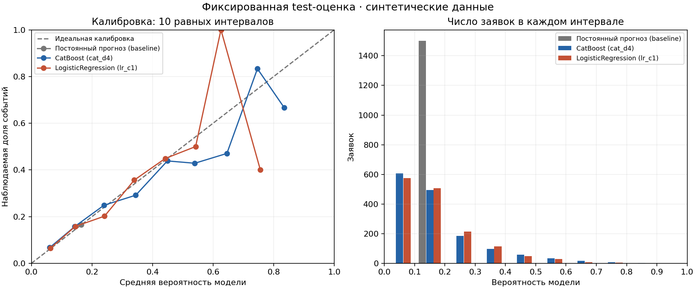
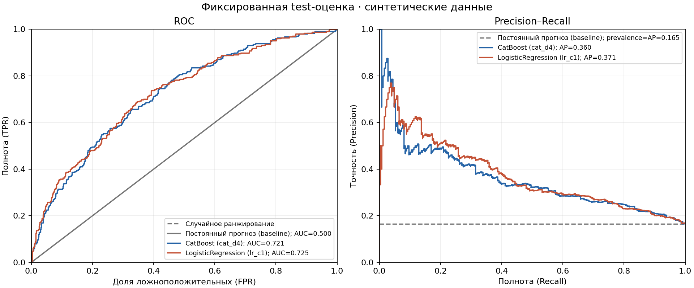

# Обучение и сравнение моделей кредитного риска

По результатам validation выбрана **LogisticRegression C=1**. У CatBoost depth=4 немного меньше Brier (0,121137 против 0,121314), но разница 0,000177 укладывается в заранее заданный допуск 0,001: при таком результате предпочитается более простая модель. Выбор сохранён до итоговой оценки на test и после неё не менялся.

Это исторический offline-эксперимент 21 октября 2026 года на 10 000 синтетических компаний. Цель `loan_90dpd_12m` — достижение 90 дней просрочки по рассматриваемому кредиту в первые 12 календарных месяцев после предполагаемой выдачи. Выбранная модель подключена к worker и API, её риск и линейные вклады доступны сотруднику. Текущая политика `demo-policy-0.4` использует модель для оборотного кредита и оборудования, сохраняя правила прежней 0.3; остальные четыре продукта рассматривает сотрудник без прогнозирования этой моделью. Новые условия двух исходных продуктов оцениваются отдельно; пороги политики не выбирались по test.

## Насколько хорош результат

На test Logistic снижает Brier относительно постоянного прогноза на **10,62%**. ROC-AUC **0,7247** означает, что в среднем модель ставит выше риск у заявки с событием примерно в 72,5% пар «событие / отсутствие события» с половинным весом равных оценок. Average Precision **0,3710** выше уровня постоянного прогноза **0,1653** примерно в 2,24 раза. Есть заметный, но умеренный сигнал: это полезная отправная точка для прототипа, а не почти безошибочное распознавание просрочки. Увеличение AP не означает такой же рост точности при любом выбранном пороге.

На этом test выбранная Logistic лучше альтернативного CatBoost по всем четырём показателям. Это описание результата, не дополнительное основание выбора: настройки уже были зафиксированы на validation. Нельзя переносить эти числа на реальные компании — синтетика воспроизводит придуманные зависимости генератора.

Эксперимент 21 октября 2026 года, Python 3.12.10, `risk-dataset-v1`, seed `20261021`. Метрики округлены до шести знаков; полные числа доступны в [validation](ml-validation.json) и [test metrics](ml-test-metrics.json). [Выбор модели](ml-selection.json) зафиксирован по validation. При подготовке публичного пакета обучение и оценивание повторно не запускались.

| Часть | Модель | Brier ↓ | ROC-AUC ↑ | Average Precision ↑ | Log loss ↓ |
| --- | --- | ---: | ---: | ---: | ---: |
| validation | Постоянный прогноз | 0.138445 | 0.500000 | 0.166000 | 0.449491 |
| validation | Logistic C=1 | 0.121314 | 0.737803 | 0.399762 | 0.395536 |
| validation | CatBoost depth=4 | 0.121137 | 0.737071 | 0.409847 | 0.394511 |
| test | Постоянный прогноз | 0.137998 | 0.500000 | 0.165333 | 0.448410 |
| test | Logistic C=1 | 0.123343 | 0.724650 | 0.371007 | 0.400824 |
| test | CatBoost depth=4 | 0.125223 | 0.721407 | 0.359898 | 0.405195 |

Validation: 1500 компаний, 249 событий (16,6%). Test: 1500 компаний, 248 событий (16,53%). Постоянная вероятность 0,164857 берётся только из train. Парный bootstrap по компаниям, 1000 перевыборок, seed `20261022`: 95% интервал разности Brier «Logistic − baseline» **[−0,020959; −0,008690]**. Отрицательные границы поддерживают преимущество над baseline на этом test; интервал не учитывает смену источника данных, повторное обучение и не подтверждает качество банковского риска.

## Как читать метрики и графики

Brier — средний квадрат разности между вероятностью и меткой 0/1; меньше лучше. Он оценивает вероятностный прогноз в целом и зависит как от калибровки, так и от способности различать случаи. Его нельзя трактовать как процент ошибочных заявок или отдельное доказательство хорошей калибровки. [Определение Brier](https://scikit-learn.org/1.7/modules/generated/sklearn.metrics.brier_score_loss.html), [калибровка вероятностей](https://scikit-learn.org/1.7/modules/calibration.html).

ROC-AUC оценивает ранжирование без одного фиксированного порога: 0,5 соответствует случайному порядку, 1 — идеальному. Average Precision (AP) суммирует precision по приростам recall, показывая поиск редких событий. Здесь используется `average_precision_score`, **не** трапецеидальная площадь под PR-кривой. Горизонтальная линия постоянного прогноза в PR проходит на доле событий test. [Определение AP](https://scikit-learn.org/1.7/modules/generated/sklearn.metrics.average_precision_score.html).

Log loss штрафует уверенные неверные вероятности; меньше лучше. Accuracy не является главным критерием: постоянный ответ «события нет» уже дал бы 83,47% на test, но не различал бы заявки и не давал индивидуальных вероятностей.

Калибровка сопоставляет среднюю вероятность с фактической долей событий в 10 равных интервалах 0–1. Близость к диагонали полезна, но верхние интервалы с малым числом заявок шумят. Пустые интервалы не соединяются с нулём; счётчики показаны на отдельном графике распределения. У baseline одна непустая точка допустима. Дополнительная калибровочная модель не обучалась.



Исторический test на синтетике: шум малонаполненных интервалов не является доказательством хорошей калибровки.



ROC-AUC и AP показаны раздельно; это один зафиксированный test, а не оценка реальных клиентов.

## Разделение и зафиксированный выбор

[Набор данных и признаки](ml-data.md) разделены по компаниям: 7000 train, 1500 validation, 1500 test. Все преобразования обучаются только на train. ID, диагностическая `true_probability`, будущие события и целевая метка не входят в модель. Test нужен для единственной итоговой оценки сохранённых победителей семейств; отчёт повторно не прогнозирует test и не подбирает по нему примеры. Эти границы защищают от утечки данных. [Рекомендации scikit-learn](https://scikit-learn.org/1.7/common_pitfalls.html).

Зафиксированы шесть кандидатов:

- Constant baseline: частота события в train.
- LogisticRegression: `C=0.1/1/10`, `solver=lbfgs`, `max_iter=2000`, `tol=1e-6`. Численные признаки: train-медиана и стандартизация; продукт: one-hot; девять явных масок: passthrough.
- CatBoost CPU: `depth=4/6`, `iterations=400`, `learning_rate=0.05`, `l2_leaf_reg=5`, `loss_function=Logloss`, `random_seed=20261021`, `thread_count=2` при fit. Категория продукта нативная, численные NaN разрешены. Без `eval_set`, early stopping, `use_best_model`, class weights и oversampling.

Внутри каждого семейства берётся минимальный validation Brier; при точном равенстве — меньший C/depth. Среди победителей семейств находится глобальный минимум. Среди вариантов с Brier не хуже `min + 0.001` порядок предпочтения: constant → logistic → catboost. Это заданное предпочтение простоты, а не статистическое равенство моделей. Сохраняются метрики всех шести кандидатов и только три модели — победители семейств. Переобучения на train+validation перед test нет.

Сохранённый [run manifest](ml-run-manifest.json) фиксирует seed, версии, хеши и условия исторического эксперимента. Публичный пакет позволяет проверить происхождение опубликованных чисел; он не содержит всего, что нужно для независимого пересчёта из готовых predictions. Побайтовое равенство моделей и результатов нового запуска на другой платформе не гарантируется.

## Ресурсы

| Модель | Fit, с | Predict validation, с | Predict test, с | Файл, КБ |
| --- | ---: | ---: | ---: | ---: |
| Постоянный прогноз | 0.000109 | 0.003383 | 0.003765 | 0.517 |
| Logistic C=1 | 0.012596 | 0.002011 | 0.002276 | 5.786 |
| CatBoost depth=4 | 0.401171 | 0.001478 | 0.002362 | 141.496 |

Окружение: Linux Docker на macOS, aarch64, Python 3.12.10, CPU quota 2, fit и BLAS ограничены двумя потоками; видимые процессу 6 логических CPU не означают квоту 6. Версии: numpy 2.2.6, pandas 2.3.3, scikit-learn 1.7.2, CatBoost 1.2.8, Matplotlib 3.10.7, joblib 1.5.2, threadpoolctl 3.6.0.

В историческом запуске 21 октября, к которому относятся приведённые метрики, времена и сохранённые артефакты, CatBoost `predict_proba` использовал native auto (`thread_count=-1`). Docker ограничивал контейнер квотой 2 CPU, но `threadpoolctl` ограничивал BLAS, а не собственный пул CatBoost. Поэтому эти timings не являются бенчмарком ровно двух native-потоков. Текущий код явно передаёт `thread_count=2` для будущих CatBoost-прогнозов; native SHAP и raw predict уже имели явный лимит 2. Это исправление не меняет сохранённые результаты и не переизмеряет их.

Функция эксперимента train/validation заняла 1,016038 с без импортов и запуска Docker. Пик RSS процесса — 236,73 МБ (236 732 416 байт), включая импорты. Функция отдельной итоговой оценки — 0,084875 с, пик RSS её процесса — 199,74 МБ (199 741 440 байт). Времена fit/predict измерены `time.perf_counter`, RSS — `resource.getrusage`. Запуск контейнера не входит в эти времена; это разовые наблюдения данной платформы, не оценка пропускной способности VPS. Единицы десятичные: КБ = 1000 байт, МБ = 1 000 000 байт. Объяснения имеют отдельный замер в [ml-explanations.json](ml-explanations.json); они не прибавляются к fit. Условия train/validation и test сохранены в [run](ml-run-manifest.json) и [test manifest](ml-test-manifest.json).

Для пяти фиксированных validation-заявок нативный SHAP альтернативного CatBoost занял 0,068898 с, точные линейные вклады выбранной Logistic — 0,006408 с. Это отдельные вызовы объяснений с проверкой raw и вероятности, без fit, загрузки моделей и запуска Docker; по пяти строкам нельзя судить о пропускной способности сервера. Полный JSON объяснений — 16,914 КБ. Графики: calibration PNG 151,700 КБ / SVG 39,289 КБ; ranking PNG 155,817 КБ / SVG 77,490 КБ. Функция построения всего отчёта заняла 0,462302 с.

## Поставка и инференс в кабинете

`backend/app/risk/models/logistic-risk-v1.json` содержит собственную выбранную модель: коэффициенты, intercept, train-медианы, средние и масштабы, порядок признаков и происхождение. JSON занимает 4833 байта и включён в Git и обычный образ `INSTALL_ML=false`; ignored-папки обучения при запуске не нужны. SHA256 и схема проверяются перед использованием. Stdlib runtime использует те же train-преобразования, прогноз и линейные вклады. Runtime JSON содержит сохранённый исторический результат parity на 1500 validation-строках; при публикации пакета parity заново не запускалась. Test для экспорта не используется. Обучение при старте, sklearn/joblib-десериализация в HTTP и GPU не нужны.

Версия `logistic-risk-v1` закрепляется в рассмотрении. Отсутствующая или повреждённая модель — техническая ошибка без кредитного решения и скрытого перехода к правилам 0.2; после исправления поставки сотрудник выполняет retry той же версии. Сохранённая история прежних рассмотрений 0.2 не пересчитывается.

Для оборотного кредита и оборудования политика `demo-policy-0.4` сохраняет правила 0.3 и допускает автоматическое одобрение при p < 0.10, K ≥ 1.30 и остальных обязательных проверках; p ≥ 0.10 передаёт заявку сотруднику, p ≥ 0.30 отмечает высокий риск. Автоматического ML-отказа нет. Повышенный риск при ручном одобрении/предложении требует подтверждения и причины; новые условия получают свою оценку той же моделью. Это согласованные демонстрационные пороги, не доказанная оптимальная банковская политика.

Отдельные исторические числа latency/RSS stdlib runtime в этот пакет не включены: первичного отчёта нет. Времена sklearn/CatBoost выше не описывают HTTP latency и не заменяют нагрузочную проверку кабинета.

## Опубликованные артефакты

В репозитории сохранён отобранный пакет исторического эксперимента 21.10.2026. Проверка целостности 26.10 подтвердила manifest-связи, согласованность метрик и связь с поставляемой моделью. Обучение, прогнозирование, пересчёт метрик/интервала и parity при подготовке пакета не выполнялись. Исторический `source_revision=null`: эксперимент не приписывается текущему коммиту.

| Исходное имя в локальном эксперименте | Публичный файл |
| --- | --- |
| `risk-data/manifest.json` | [ml-data-manifest.json](ml-data-manifest.json) |
| `risk-data/report.json` | [ml-data-report.json](ml-data-report.json) |
| `risk-models/manifest.json` | [ml-run-manifest.json](ml-run-manifest.json) |
| `risk-models/selection.json` | [ml-selection.json](ml-selection.json) |
| `risk-models/validation.json` | [ml-validation.json](ml-validation.json) |
| `risk-models/evaluation/manifest.json` | [ml-test-manifest.json](ml-test-manifest.json) |
| `risk-models/evaluation/metrics.json` | [ml-test-metrics.json](ml-test-metrics.json) |
| `risk-models/analysis/manifest.json` | [ml-report-manifest.json](ml-report-manifest.json) |
| `risk-models/analysis/calibration.png` | [ml-calibration.png](ml-calibration.png) |
| `risk-models/analysis/ranking.png` | [ml-ranking.png](ml-ranking.png) |
| `risk-models/analysis/explanations.json` | [ml-explanations.json](ml-explanations.json) |

Исходные имена указаны относительно `backend/artifacts/` исторического run. Содержимое файлов и ключи manifest сохранены без редактирования; публичные имена отличаются по таблице. Часть исходного inventory намеренно отсутствует: полные CSV, predictions, SVG и offline бинарные модели. Поэтому нельзя рекурсивно проверить весь inventory относительно `docs/` или считать пакет полным архивом. Для нового самостоятельного эксперимента используйте команды ниже и [генерацию данных](ml-data.md#сборка); это не независимая проверка байтов старого run.

## Запуск обучения без БД и HTTP-сервера

Из `backend`, Python 3.12 и uv; нужен существующий набор `artifacts/risk-data`:

```sh
uv sync --frozen --extra ml
uv run --extra ml python -m app.risk train-models --data artifacts/risk-data --output artifacts/risk-models
# После проверки сохранённого выбора — один итоговый проход test:
uv run --extra ml python -m app.risk evaluate-models --data artifacts/risk-data --run artifacts/risk-models
uv run --extra ml python -m app.risk report-models --data artifacts/risk-data --run artifacts/risk-models
```

Через Docker из корня проекта:

```sh
docker build --build-arg INSTALL_ML=true -t smart-credit-ml ./backend
mkdir -p backend/artifacts
docker run --rm --cpus=2 --network none \
  -v "$PWD/backend/artifacts:/app/artifacts" \
  smart-credit-ml uv run --extra ml python -m app.risk train-models \
  --data artifacts/risk-data --output artifacts/risk-models
# Только после проверки выбора:
docker run --rm --cpus=2 --network none \
  -v "$PWD/backend/artifacts:/app/artifacts" \
  smart-credit-ml uv run --extra ml python -m app.risk evaluate-models \
  --data artifacts/risk-data --run artifacts/risk-models
docker run --rm --cpus=2 --network none \
  -v "$PWD/backend/artifacts:/app/artifacts" \
  smart-credit-ml uv run --extra ml python -m app.risk report-models \
  --data artifacts/risk-data --run artifacts/risk-models
```

`DATABASE_URL`, `DEMO_PASSWORD` и `.env` этим командам не нужны. Сеть нужна при установке зависимостей/сборке образа; запуск готового образа работает с `--network none`. ML extra необязателен для обычного кабинета и сборки данных; без него команды обучения/оценки/отчёта сообщают, как установить зависимости.

Существующие каталоги не перезаписываются: `train-models` требует новый run, `evaluate-models` — отсутствие `evaluation/`, `report-models` — отсутствие `analysis/`. Для уже принятого run выполните только ещё не выполненный шаг; повторная test-оценка не нужна. Новый самостоятельный эксперимент сохраняйте в другой каталог.

## Результаты нового запуска и объяснения

Локальный каталог `backend/artifacts/risk-models/` исключён из Git. В нём находятся `selection.json`, `validation.json`, `validation-predictions.csv`, три модели в `models/` и `manifest.json`. В `evaluation/` — итоговые `metrics.json`, `predictions.csv`, связанный с run manifest. Загрузка проверяет версии Python/библиотек, признаки, fingerprint данных и SHA256. Это проверка целостности, не удостоверение доверенного происхождения: загружать разрешено только собственные локальные артефакты. Чужой `joblib` может выполнять код при десериализации; не используйте непроверенные файлы. [Ограничения сохранения моделей](https://scikit-learn.org/1.7/model_persistence.html).

`report-models` создаёт `analysis/comparison.md`, `explanations.json`, `calibration.png/.svg`, `ranking.png/.svg` и manifest с источниками/контрольными суммами. Таблицы берутся из сохранённых метрик; графики — из сохранённых test-прогнозов и интервалов калибровки. Модели не переобучаются, выбор не меняется. Для объяснений используются первые пять validation-заявок по `application_id`, а не наиболее наглядные случаи из test.

Выбранную Logistic объясняют **точные линейные вклады в пространстве преобразованных входов**: train-медианы, стандартизованные числа, one-hot продукта и маски. База — intercept; сумма базы и вкладов восстанавливает raw log odds. Это не SHAP и не вклад в процентных пунктах вероятности.

Для **альтернативного CatBoost** используется нативный `ShapValues` с категорией `product_code`, без дополнительного пакета shap. Базовый прогноз и 18 вкладов возвращаются в `raw_log_odds`. Проверяется `base + sum(contributions) = raw` и `sigmoid(raw) = P(class=1)` с абсолютным допуском 1e-8; нечисловой или неаддитивный результат отклоняется. [Определение CatBoost SHAP](https://catboost.ai/docs/en/concepts/shap-values).

JSON сохраняет ID заявок и моделей, все исходные входы, базу, полные вклады, raw и вероятности. Markdown показывает до трёх повышающих и до трёх снижающих вкладов, оставляя пустое направление пустым. Русские названия отличают признаки, пропуски и преобразования. SHAP и линейные вклады описывают прогноз конкретной модели; они не доказывают причинность, эффект изменения признака или причину окончательного кредитного решения.

Открыты проверка на реальных данных, экономическая проверка порогов политики и оценка последствий решений. Интеграция API/UI использует только синтетический риск и не подтверждает качество реального кредитования. Иная цель (например, событие за весь срок договора) требует отдельного эксперимента и версии разметки: сравнение её AUC с годовой целью само по себе не доказывает улучшения.
